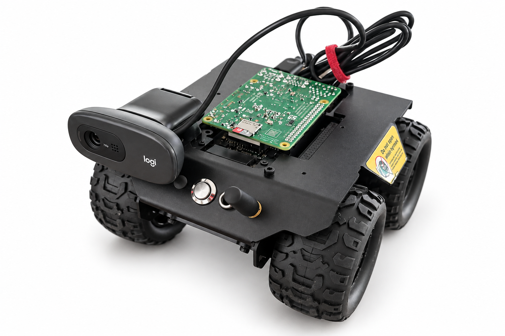

# Webwizards Rover

Operating knowledge, source code, recovery tools and design assets for the owner's Raspberry Pi 4 / WAVE ROVER prototype. It runs Raspberry Pi OS Lite 64-bit, Chromium, a USB camera, Bluetooth audio and a cellular modem.



The product photograph uses AI-assisted background cleanup; it is not an engineering reference.

## Start here

- [Reusable agent skill](SKILL.md) and [repository instructions](AGENTS.md).
- [Routine operation and service map](references/operations.md).
- [Provisioning](references/provisioning.md) and [camera troubleshooting](references/troubleshooting.md).
- [Cellular and controller networking](references/networking.md).
- [Public controls and movement protection](references/controls.md).
- [Speaker and browser audio](references/audio.md).
- [Publication manifest](docs/publication.md).

## Links

| Purpose | Address |
|---|---|
| Robot camera publisher | https://stampnote-omega.vercel.app/robotic-control |
| Administrator viewer | https://stampnote-omega.vercel.app/live-tunnel |
| Permanent controls | https://rover.webwizardsg.com |
| SSH on the same network | `ssh rover@roverpi.local` |

The controls require a private key, deliberately absent from this repository. A permanent hostname does not guarantee a powered-off or disconnected robot is reachable. SSH has not been exposed through this controls URL.

## Last verified state — 3 October 2026, Singapore time

- Camera publication returned after the owner upgraded the StampNote Firebase project to Blaze. The existing signed-in Chromium profile was preserved; changing remote images were observed.
- Named Cloudflare tunnel and relay initially came up after the owner restored power. Later the public link returned HTTP 502/530: the modem had an IP address, but cellular HTTPS timed out while Wi-Fi HTTPS returned 200. The local relay remained healthy.
- **Driving enabled**, as requested. Updated controls start at 30% of the stock full-speed setting, cap it at 50%, reject stale commands and use a local stop watchdog. The owner reports the earlier signal-loss stop works. The higher-speed revision passed simulated checks but has **not** been physically driven during verification.
- After the owner restored power, the Pi booted with cellular as the preferred route. The public tunnel later lost its edge connections while the local controls remained healthy; this cellular interruption is unresolved.
- Earlier temperature peaked at 84.7°C and battery telemetry fell to 8.4 V before the battery ran out. After power was restored, temperature was 59.4°C and battery telemetry about 11.8 V.
- Boot persistence is configured. The newest cellular, public tunnel and motion changes have **not** been tested together through a complete cold boot.

These are dated observations, not live status. See the [recovery record](docs/history/rover-recovery-and-motion-2026-10-03.md).

## Contents

| Directory | Contents |
|---|---|
| `references/` | Maintained operating and recovery instructions |
| `scripts/`, `assets/` | StampNote launcher, boot unit, installer and optional SSH/SCP helpers |
| `controls/` | Authenticated relay, motion leases, browser controls, tunnel recovery, controller Wi-Fi helper and tests |
| `cellular/` | UFI Android USB-tether helper source/APK and Pi recovery timer |
| `audio/` | MS-PS1CN reconnection and PulseAudio routing |
| `docs/history/` | Sanitized dated diagnostic records; later evidence takes precedence |
| `design/v2/` | Revised editable Blender model, GLB, build source and renders |
| `design/v1/` | Earlier model, retained as an explicitly superseded revision |
| `pitch/` | September pitch deck, editable build source and cleaned product photos |

The pitch deck is historical; its capability claims have not been rewritten for later deployment changes. Model dimensions are estimated, not fabrication CAD.

## Test locally

Requires Python 3 and Node.js. Tests use fake controllers and browser objects; they do not connect to the robot.

```sh
cd controls
python3 -m unittest test_motion test_relay -v
node --test test-motion-client.cjs
```

The current implementation passed 12 motion tests, 7 HTTP relay tests and 7 browser logic tests. Inspect the relevant reference before deploying.

## Credentials and provenance

Keep credentials outside this checkout. On the Pi, the control key is `~/.config/rover-controls/key` and the connector token is `~/.config/rover-controls/tunnel-token`, both mode 0600. Never commit Chromium profiles, SD-card personalization, private keys, Firebase login tokens or modem APK signing keys.

See [THIRD_PARTY.md](THIRD_PARTY.md) for dependencies and design attribution.
