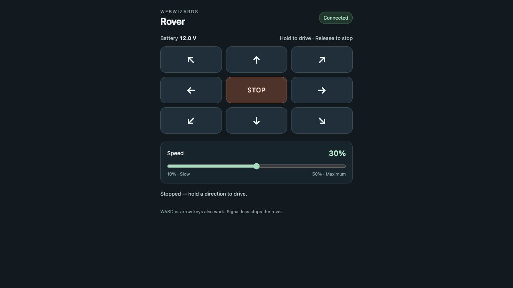

# Public controls and motion protection

## Public route

Permanent URL: https://rover.webwizardsg.com

Namecheap is the registrar; Cloudflare manages/proxies the existing domain.
No registrar or nameserver move was necessary. A named remotely managed tunnel
`rover-controls` maps this hostname to `http://127.0.0.1:8877`, with a404 fallback.
The installed connector uses a token file, HTTP/2 and IPv4. The old Quick Tunnel
is disabled; its random trycloudflare address must not be restored.

On the Pi:
- Source: `/home/rover/rover-public-control/`.
- Control key: `~/.config/rover-controls/key`,0600.
- Connector token: `~/.config/rover-controls/tunnel-token`,0600.
- Configuration directory mode0700.
- Services: rover-controls and rover-controls-named-tunnel, user units.

The landing page accepts the private control key, or the owner can use
`https://rover.webwizardsg.com/#key=<PRIVATE_CONTROL_KEY>`.
Treat the full keyed URL as a credential. The public base URL alone does not unlock
the controller. The key is sent as X-Rover-Key to the relay; it is never put in an
upstream controller URL or request log.

The relay authenticates requests, restricts paths, uses constant-time key comparison,
sends no-store/no-referrer headers, and permits embedding by the StampNote origin.
The compact page is maintained in `controls/controls.html`; it no longer loads
the manufacturer's settings and command console. Its inline script uses
`data-cfasync="false"` because Cloudflare Rocket Loader previously deferred dynamically loaded scripts. Do not
disable Cloudflare protections globally to repair this one page.

## Diagnose "refused to connect" or Host Error

Check independently:
1. Controller: `curl --max-time 5 http://192.168.4.1/`.
2. Relay landing: `curl --max-time 5 http://127.0.0.1:8877/`.
3. Tunnel: `curl --max-time 5 http://127.0.0.1:20242/ready`.
4. Public URL from another machine; inspect HTTP status and headers.
5. Authenticated telemetry using read-only T130; do not send motion to test connectivity.

Observed failure: public HTTP530 with X-Frame-Options:SAMEORIGIN while local relay
and controller returned200. Cloudflare's error page cannot be embedded, so Chrome
shows "refused to connect". This is not evidence of a permanent CSP problem.
HTTP502 can mean the connector cannot reach its local origin, or the relay cannot
reach the controller; distinguish the response body and local checks.

Stopping the relay intentionally produces a Host Error even if the tunnel is up.
A running cloudflared process or local /ready response alone cannot prove public
reachability when sockets have gone stale.

## Route recovery

The user timer checks every5 seconds. It compares device, gateway, source address
and Linux ifindex, catching a modem that disappears and returns with the same IP.
It requests a connector restart after a route/interface change or60 seconds of
failed local readiness. It leaves startup to systemd.

cloudflared's grace period was reduced from30 seconds to2 seconds and systemd's
stop timeout is5 seconds. This shortens observed reconnect delays; it cannot keep
a tunnel online without working internet. Do not describe this as carrier-level
failover or an always-online guarantee.

## Why a quick tap previously drove too far

The stock controller page starts at full speed, sends press/release as separate
asynchronous HTTP requests and repeats its last speed every1500 ms. Release
cancellation/focus handling was incomplete. Delay, reordering or a lost release
could prolong motion. The Pi-to-Cloudflare link uses HTTP/2 over TCP, but TCP alone
was not proven to be the incident's cause.

## Deployed protection

- Browser pointer capture and stop on release, cancellation, pointer leave,
  lost capture, focus loss, hidden page and page exit; keyboard holds supported.
- No stock 1.5-second motion heartbeat.
- Authenticated POST prepare/drive/stop API with monotonic per-session sequences.
- Server-issued one-use tokens expire500 ms after issue, not500 ms after a delayed
  packet arrives. Expired/replayed commands are rejected.
- A local worker alone sends wheel commands and stops when the current lease expires.
- Controller runtime watchdog T136 cmd350 is configured on connection.
- Raw wheel commands T1/T11/T13 and watchdog edits T136 cannot bypass the API.
  An authenticated raw zero-speed T1 remains an emergency stop.
- Initial speed 30%, maximum 50% of stock full speed (absolute L/R<=0.25).
- Production unit explicitly includes `--enable-drive`. Code defaults to disabled
  without that flag; preserve the owner's requested enabled production mode.

These layered timeouts reduce prolonged movement. They do not prove a physical
stopping distance or an absolute real-time bound under hardware/controller failure.
The October3 changes passed simulated tests, not a physical driving test. On a
laggy connection, leases may expire and require releasing and pressing again;
do not remove the expiry merely to hide network instability.

## Deploy the source

This is an existing-deployment layout, not an unattended first-boot installer.
After confirming the controller address and retaining private credentials, back
up existing files and copy the runtime `relay.py`, `motion.py`, `motion-client.js`,
`controls.html` and `tunnel-network-check.py` from `controls/` into
`/home/rover/rover-public-control/`. Install the controls/tunnel/network-check
service and timer files into the rover user's `~/.config/systemd/user/`.
The controller Wi-Fi unit belongs in `/etc/systemd/system/` and its helper in
`/usr/local/sbin/`; it also needs the private NetworkManager AP profile.

Validate systemd units before reloading, preserve `--enable-drive`, and verify
the external page after restarting changed services. Reload old browser control
frames: they do not automatically acquire the new event handlers.

Run the README tests against fake controllers. For an actual motion/stopping test,
use a user-supervised safe setup; never make forward movement part of a network probe.

[Manufacturer watchdog command](https://www.waveshare.com/wiki/08_Sub-controller_JSON_Command_Set)

## Simplified driving page — 3 October 2026

The owner requested more speed and removal of irrelevant UI after powering the Pi
back on. The page now keeps eight movement directions, Stop, a 10–50% speed slider,
battery voltage and connection status. Default speed is 30%. Gimbal, GPIO, network
settings and the raw JSON console are absent from this view. The local manufacturer
controller page was not modified.

Changing the slider during a hold sends a stop and requires a fresh press. Space
and Escape stop, in addition to release/cancel/focus/visibility handling. Battery
telemetry is read-only T130 and displays voltage, not an invented charge percentage.
The page loads independently of controller availability and never starts motion on
opening or reconnecting. Existing authentication and the 500 ms lease / 350 ms
controller watchdog remain.

The code passed 12 simulated motion tests, seven relay tests and seven browser
logic tests. The local browser preview had no console errors. The deployed Pi
reported enabled=true, ready=true, maxSpeed=0.25, leaseMs=500 and watchdogMs=350.
No nonzero wheel command was sent during deployment verification.

